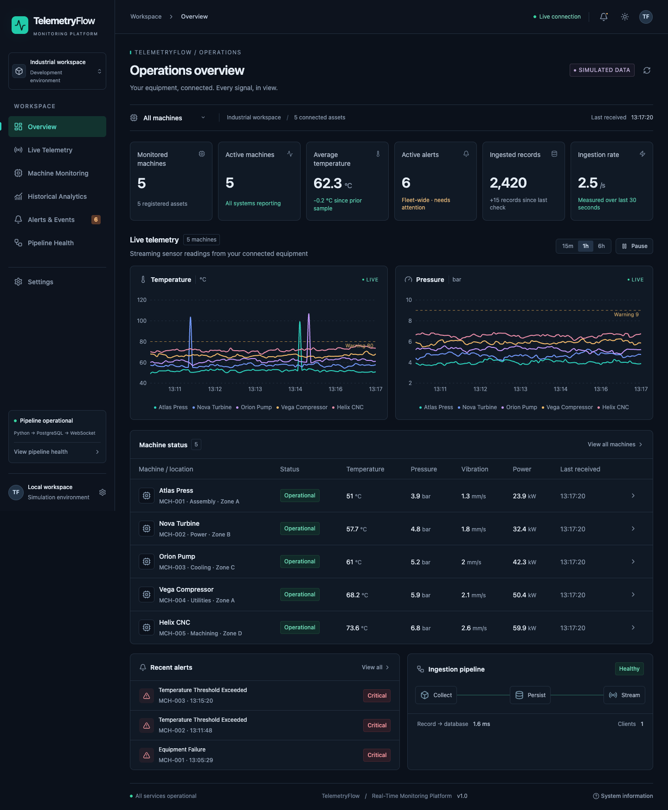
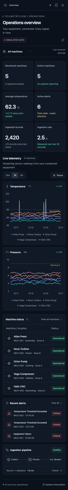
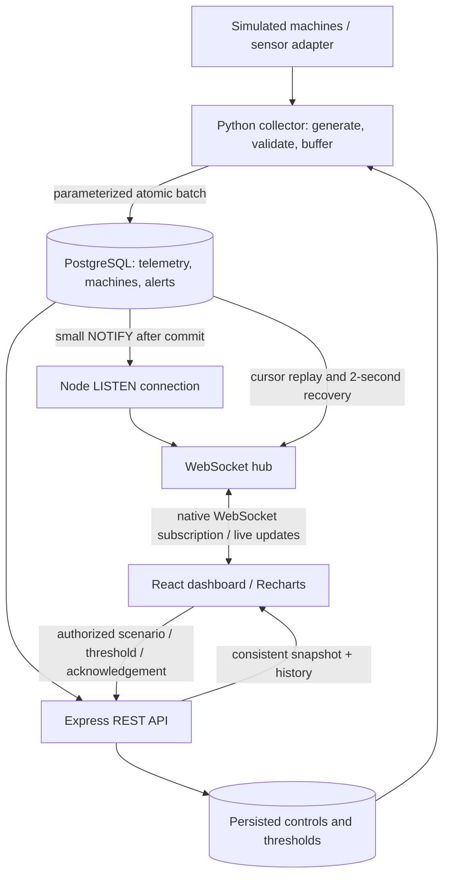
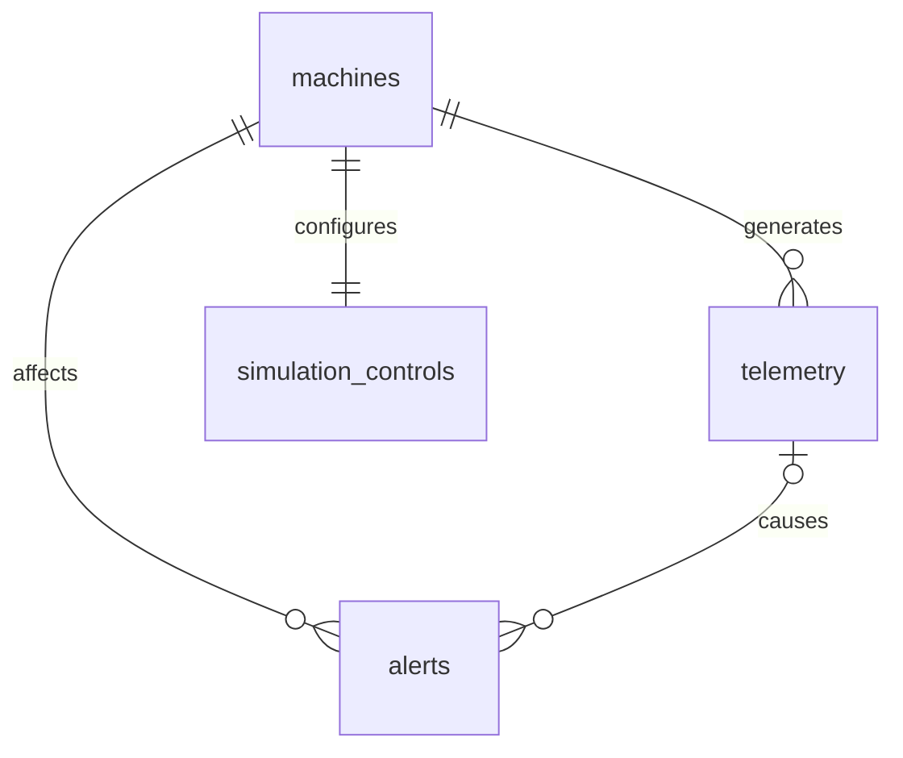

# TelemetryFlow — Real-Time Monitoring Platform

A working industrial telemetry pipeline with a React monitoring dashboard, an independent Python collector, PostgreSQL persistence, and a Node.js WebSocket gateway.

In simple terms: five simulated machines send measurements to a database, and the dashboard shows their changing condition without a page refresh. Stop the dashboard or backend and collection can continue. Reconnect and persisted readings catch up.

Technically: Python validates and transactionally ingests telemetry through psycopg; PostgreSQL enforces constraints and creates threshold alerts; LISTEN/NOTIFY wakes an Express/`ws` gateway, which queries committed rows and streams them to React. REST provides a consistent initial snapshot, filtered history, analytics, controls and health. This is a **local, single-user demonstration with simulated equipment**, not a connection to physical industrial hardware.

## Start the application

Prerequisites: Docker with Compose v2.24+ and Python 3 for the credential setup helper. Run from this directory:

```bash
./scripts/setup.sh
docker compose up --build -d
```

Open **http://localhost:8080**. Wait for the first readings; five machines produce a batch every two seconds by default. No sample readings or dashboard statistics are hardcoded. Random local credentials are generated into ignored `.env`. Enter its `ADMIN_TOKEN` value in **Settings → Control access** to run scenarios, change thresholds, or acknowledge alerts. The token stays in tab memory and clears on refresh.

```bash
docker compose ps
docker compose logs -f ingestion backend
docker compose down
```

`down` preserves the database volume. Never add `-v` when you want to keep data. All exposed ports bind to loopback; this application is not configured for public administrative access.

## Actual dashboard screenshots

Captured in Chrome while Python, PostgreSQL and the real WebSocket pipeline were running. Charts include readings generated during scenario tests.



<details>
<summary>Mobile dashboard (390 px)</summary>



</details>

## Implemented features

- Five distinct seeded machines with gradual, mean-reverting fluctuations, occasional anomalies, unique events and UTC timestamps. Expand to 100 registered simulators through configuration.
- Validation, pipelined transactional batches, idempotent inserts, exponential retry, reconnection, bounded buffering, structured logs, retention and graceful shutdown.
- Indexed PostgreSQL history, transactional threshold alerts, configurable high limits and cooldowns, persistent simulation controls and measured ingestion health.
- Bounded REST queries with input validation, cursor pagination, connection pooling, readiness, controlled errors, Origin/CORS checks, rate limits and token-protected mutations.
- Native WebSockets: multi-client delivery, machine subscriptions, ping/pong, automatic reconnect, database catch-up, duplicate handling, backpressure and snapshot/live race protection.
- Seven functional views: overview, four live metric charts, machine monitoring/details, historical analytics, alerts/events, pipeline health, and settings.
- Global filtering, comparison lines, threshold references, live pause/resume, date/metric filters, minute aggregates, min/max/average/count, paginated readings, and CSV export.
- Dark/light themes, responsive navigation, clear simulated-data labels, loading/error/empty states and accessible controls.
- Docker Compose, dependency lockfiles, automated tests, real browser screenshots, reproducible benchmarks and documented limits.

## Architecture



**Why polyglot?** Python and JavaScript have separate processes and responsibilities, joined by a database contract. Replacing a simulated source with a sensor/API adapter does not require rewriting React. Database-backed decoupling improves fault isolation and makes each layer independently testable. Shared schema changes and the database dependency still require coordination.

**Recovery matters:** NOTIFY is a signal, not a durable message queue. Node retrieves real persisted rows after a cursor. A two-second recovery scan handles missed signals. A repeatable-read REST bootstrap and committed watermark close the history/live transition gap. Every supported ingestion writer takes the same transaction lock **before** allocating row IDs, preventing a smaller ID from committing after a cursor has passed it. Read [ARCHITECTURE.md](docs/ARCHITECTURE.md) and [WEBSOCKETS.md](docs/WEBSOCKETS.md) for guarantees and trade-offs.

## Technology choices

| Technology | Job here | Why / limitation |
|---|---|---|
| Python 3.11 + psycopg 3 | Collection, validation, batch writes | Clear sensor-adapter code and mature PostgreSQL driver; one synchronous loop |
| PostgreSQL 17 | Source of truth, SQL analytics, constraints, notifications | Transactions and indexes in one service; NOTIFY is not a queue |
| JavaScript + Express 5 + node-postgres | HTTP API, controls, pool, listener | Small async backend with explicit SQL; manual validation/security remain necessary |
| Native WebSocket + ws | Subscription and real-time delivery | Bidirectional low-overhead stream; replay/heartbeat are application responsibilities |
| React 19 + Vite 7 | Interactive dashboard and build | Component/hook lifecycle fits live views; rendering must be bounded |
| Tailwind CSS 4 + authored CSS | Theme base, utilities and responsive design | Flexible design tokens without a large component framework |
| Recharts 3 + Lucide | Charts, thresholds, tooltips and icons | Readable React integrations; SVG point count is capped |
| REST APIs | Snapshots, history, commands | Easy to inspect with cURL; live pushes use WebSockets |
| Docker / Compose / nginx | Reproducible local services and proxy | Portable runtime setup, not a production orchestrator |
| Pytest, Vitest, Supertest, Playwright | Unit, integration and browser validation | Real database/socket coverage plus UI checks |

[TECHNOLOGIES.md](docs/TECHNOLOGIES.md) explains every major tool, alternatives and limitations, and maps fundamental concepts—including ACID, TCP, indexes, event loops, React hooks, ETL/ELT and scaling—to source files.

## Follow one reading

1. `Simulator.collect()` in `ingestion/simulator.py` generates a source observation with a stable event UUID.
2. `Collector.enqueue()` calls `validator.validate()`; `Collector.flush()` sends a bounded batch to `Database.write_batch()`.
3. `ingestion/database.py` uses parameterized SQL, `ON CONFLICT(event_id) DO NOTHING`, a writer-order lock and one transaction. The SQL trigger in `database/01-schema.sql` creates eligible alerts.
4. After commit, `listener.js` wakes `Hub.pump()` in `backend/src/websocket/hub.js`. It reads `SELECT * FROM telemetry WHERE id>$1 ORDER BY id LIMIT 500` and broadcasts `telemetry_update`.
5. `useTelemetry()` in `frontend/src/hooks/useTelemetry.js` merges the event into bounded state. `TelemetryChart` and `Machines` redraw from persisted data.

Example telemetry shape (illustrative):

```json
{
  "id": "126",
  "event_id": "526c6038-a16c-4eb5-b739-3415d5682370",
  "machine_id": "MCH-001",
  "sensor_id": "MCH-001-S01",
  "temperature": 54.6,
  "pressure": 4.12,
  "vibration": 1.24,
  "power": 25.7,
  "status": "running",
  "recorded_at": "2026-11-24T07:00:00.000Z",
  "ingested_at": "2026-11-24T07:00:00.006Z"
}
```

`id` is the string-encoded database cursor, `event_id` the deduplication key, and machine/sensor IDs identify the source. Units are °C, bar, mm/s and kW. Status is running/warning/critical/offline. `recorded_at` is source UTC time; `ingested_at` is database insertion time. [WORKFLOW.md](docs/WORKFLOW.md) traces the functions, SQL and messages in full.

## Database



`telemetry` has a BIGSERIAL primary key, unique UUID event key, machine foreign key, NOT NULL measurements and numeric/status CHECKs. `alerts` records the source reading, metric, observed/threshold values, severity and acknowledgement. `thresholds` and `ingestion_health` hold configuration and measured state.

The `(machine_id, recorded_at DESC, id DESC)` B-tree serves machine/time history. Separate event-time and ingestion-time indexes support bounded queries and rate metrics; the primary-key index serves replay. Alert indexes support active lists and cooldown lookup. Transactions keep inserted readings, alerts, health and notification consistent.

See [DATABASE.md](docs/DATABASE.md) for keys, transactions, indexing, retention, pooling and performance analysis, and [queries.sql](docs/queries.sql) for executable latest/history/hourly/abnormal/critical/EXPLAIN examples.

## Repository map

```text
frontend/       React application, pages, hook, chart, styling, UI tests, nginx
backend/        Express routes/controllers/services, pg pool, listener, ws hub, tests
ingestion/      Python simulator, validator, collector, DB adapter, configuration, tests
database/       Schema, indexes, seed and self-contained PostgreSQL image
scripts/        Setup, local launch, initializer, browser/outage checks and benchmarks
docs/           Architecture, guides, measured JSON reports and actual screenshots
docker-compose.yml     Standard four-service local deployment
docker-compose.qa.yml  Independent QA ports and Origin override
.env.example           Configuration template, no live credentials
package-lock.json      Locked JavaScript dependency tree
Makefile               Common setup/build/test/Compose commands
```

Important files: `backend/src/app.js` composes security and routes; `controllers/api.js` implements validated endpoints; `services/telemetry.js` owns SQL query logic; `websocket/hub.js` owns replay and liveness. `frontend/src/App.jsx` owns navigation/scope; `hooks/useTelemetry.js` owns snapshot/live state. `ingestion/collector.py` owns reliability policy, while `database.py` owns transactions. The docs provide a more detailed walkthrough.

## Installation on macOS, Linux and Windows

**macOS:** Docker Desktop or a working Colima + Docker Compose installation. **Linux:** Docker Engine and Compose v2 plugin, with permission to access its daemon. **Windows:** Docker Desktop using Linux containers and WSL2; run the repository and commands inside an Ubuntu WSL shell. Docker is the recommended cross-platform route. Setup needs Python 3 only to create random credentials.

For manual local development, use Node 22.12+ (22 used in containers), Python 3.11, npm and PostgreSQL 17. Node 25 and Python 3.11 were also exercised on the development host. Other runtime versions/platforms are not claimed as tested.

```bash
./scripts/setup.sh
docker compose up --build -d db
npm ci
python3.11 -m venv .venv
source .venv/bin/activate
pip install -r ingestion/requirements.lock.txt
python scripts/with-env.py python scripts/init-db.py
```

If PostgreSQL is installed manually, create the database/user and set the real private `DATABASE_URL` in `.env` instead of starting the DB container. The initializer leaves an existing schema intact.

Run in separate terminals from the root:

```bash
python3 scripts/run-local.py backend
python3 scripts/run-local.py ingestion
npm run dev
```

Open **http://127.0.0.1:5173**. The Python launchers read `.env` without logging credentials; `npm run dev -w backend` is an alternative with file watching. [COMMANDS.md](docs/COMMANDS.md) includes every important command, directory, purpose, expected result and database inspection example. There is no published Git remote yet; no fictitious clone URL is supplied.

## Configuration and limits

| Setting | Default | Effect |
|---|---|---|
| `INGEST_INTERVAL` | 2 seconds | Allowed 0.1–60 s; one collection cycle per interval |
| `MACHINE_COUNT` | 5 | 5–100 simulated machines; extra assets persist when registered |
| `SIMULATION_SEED` | 42 | Reproducible values/scenarios, not UUIDs or wall-clock times |
| `BUFFER_LIMIT` | 5,000 readings | Oldest-first overflow drop with log/counter |
| `BATCH_SIZE` | 500 | 1–1,000 events per flush, one transaction |
| `RETENTION_DAYS` | 7 | Incremental deletion, 10,000 old rows/table/minute |
| `ALLOWED_ORIGINS` | Local frontend origins | Exact Origin allowlist for browser HTTP and WebSocket requests |
| `ADMIN_TOKEN` | Random at setup | All mutations; never bundled into frontend |

Other fixed limits: REST pages 1,000; history windows 31 days; chart buckets 2,000 for historical aggregation; CSV 10,000 rows; bootstrap 1,000 readings; live browser buffer 1,500; roughly 180 chart points; chart state updates 2 Hz; 50 sockets; 1 MiB outbound backpressure; 2 KiB socket messages; 16 KiB JSON request body. Staleness is 15 seconds by default, extended to three collection intervals for slower configurations.

## API and controls

| Method | Endpoint | Purpose |
|---|---|---|
| GET | `/api/health`, `/api/ready` | Database/schema readiness |
| GET | `/api/bootstrap` | Consistent initial data and live cursor |
| GET | `/api/machines`, `/api/machines/:id` | Asset list/details |
| GET | `/api/telemetry/latest` | Latest event-time reading per machine |
| GET | `/api/telemetry/history` | Filtered, paginated persisted readings |
| GET | `/api/telemetry/summary` | Minute aggregates and min/max/average/count |
| GET | `/api/alerts` | Severity/status/machine filtered alert pages |
| PATCH | `/api/alerts/:id/acknowledge` | Idempotent acknowledgement; token required |
| GET | `/api/system/stats` | Actual pipeline health and counters |
| GET / PATCH | `/api/thresholds`, `/api/thresholds/:metric` | Read/edit thresholds; mutation requires token |
| POST | `/api/simulation` | Persist machine scenario; token required |

Scenarios: normal/return to normal, temperature spike, excessive vibration, pressure anomaly, and machine failure. The backend writes controls and Python applies them. [API_REFERENCE.md](docs/API_REFERENCE.md) specifies parameters, bodies, response examples and status codes. [WEBSOCKETS.md](docs/WEBSOCKETS.md) covers the handshake, message protocol, recovery and HTTP/SSE alternatives.

## Verification and performance

```bash
python3 scripts/with-env.py .venv/bin/pytest ingestion/tests -q
python3 scripts/with-env.py npm test
python3 scripts/with-env.py node scripts/e2e.mjs
npm run build
```

Observed results: **21 Python tests, 12 backend tests, and 10 frontend tests passed**, including real PostgreSQL integration in isolated schemas. **12 browser end-to-end checks passed** with no page errors, including real data, scenarios, acknowledgement, CSV, reconnect, light mode and mobile navigation. The actual four-service Compose deployment was built and started. Controlled collector/backend/database outages recovered with no duplicate events. See [IMPLEMENTATION_REPORT.md](docs/IMPLEMENTATION_REPORT.md), [e2e-results.json](docs/e2e-results.json), and [outage-results.json](docs/outage-results.json).

Run reproducible performance checks:

```bash
python3 scripts/with-env.py .venv/bin/python scripts/benchmark.py
node scripts/stream-benchmark.mjs
```

Benchmarks cover 5/25/100 machines, two intervals, batch versus individual writes, real API latency, a 100,000-row indexed/unindexed query, and actual WebSocket receipt. The separate 30-second stream run measured **14 ms median / 18 ms p95** generation-to-client delivery (75 readings). These are local measurements, not production capacity guarantees or browser paint latency. [PERFORMANCE.md](docs/PERFORMANCE.md) records the complete results, sample counts, hardware and limitations; raw JSON is included. No unexecuted benchmark is presented as measured.

## Reliability trade-offs and security

A temporary DB outage retains readings in memory after startup. Retries reuse UUIDs and can safely replay an ambiguous commit. At capacity, the oldest readings are dropped and logged; a collector crash loses buffered memory. SQL-backed failure/drop counters update only when the DB returns. NOTIFY offers no durable queue guarantee, and stream recovery ends at retained data.

This release supports a single collector/backend deployment. All writers must honor the ordering lock; arbitrary concurrent SQL writers can violate the cursor contract. Read endpoints and WebSocket data are unauthenticated for a trusted local demo. Mutations require a control token, but public deployment additionally needs TLS, user authentication/authorization, audit trails, least-privilege DB roles, secret management, backups and gateway limits. Do not expose the simulation API publicly with this configuration.

Retention is gradual, not an absolute disk quota. Active alerts remain active until acknowledged; no incident auto-resolution is implemented. Live charts deliberately omit intermediate points at high rates. Historical CSV exports are bounded. Cross-service timestamp latency requires synchronized clocks. These limits are explicit rather than hidden behind fabricated statistics.

[CHALLENGES.md](docs/CHALLENGES.md) explains ten engineering risks, alternatives, selected solutions, code snippets and tests, and separates anticipated risks from issues actually observed. [TROUBLESHOOTING.md](docs/TROUBLESHOOTING.md) covers startup, Docker, database, control access, clocks, history and recovery.

## Future improvements

Replace the simulator with actual sensor/API/MQTT adapters; add disk-backed spooling or a durable broker for stronger delivery guarantees; use partitioned tables/TimescaleDB for long retention; add a latest-state table and shared replay cache for larger fleets; implement user identity, audit history, alert incidents/hysteresis, backups, and deployment telemetry. Kafka, Redis, cloud hosting and horizontal scaling are future options, **not implemented dependencies**.

Licensed under [MIT](LICENSE).
