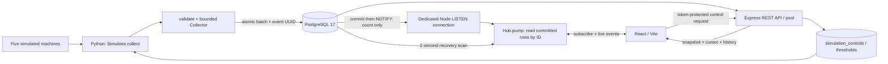

# Architecture

Think of PostgreSQL as the shared logbook. Python writes observations into it; Node reads them and tells dashboards what changed. Neither service needs to know how the other implements its work.

## Service responsibilities

| Service | Responsibility | Boundary |
|---|---|---|
| Python, `ingestion/` | Stateful simulation, validation, buffering, transactional ingestion, heartbeat, retention | No browser connections |
| PostgreSQL, `database/` | Constraints, event uniqueness, alert creation/cooldown, persistent controls and readings | NOTIFY contains no telemetry batch |
| Express, `backend/src/` | Query validation, bounded REST queries, controls, security, health | Does not generate sensor readings |
| WebSocket hub | Retrieve persisted rows and catch up each subscribed client | Cursor and subscription are connection state |
| React, `frontend/src/` | REST bootstrap, live merge, charts and interactions | No invented operational statistics |
| nginx, container only | Serve built frontend and proxy `/api` and `/ws` | Ports bind to host loopback |

This is **polyglot** architecture because it combines Python and JavaScript in independently running services. SQL is the common data contract. The languages fit their responsibilities without adding Kafka, Redis, or another broker.

**Separation of concerns** keeps sensor adapters out of the UI. **Loose coupling** means a new sensor collector can keep the same table/event contract and leave React unchanged. It also gives fault isolation: a stopped backend does not prevent Python from persisting data. Schema migrations still require coordination; a database failure affects all services.

## Durable state and recovery

`Database.write_batch()` takes transaction advisory lock `74101` **before allocating telemetry sequence IDs**. All supported ingestion writers use this lock. This makes visible ID order follow commit order, so `WHERE id > cursor` cannot skip a late-committing smaller ID. Serial sequences alone do not provide that guarantee. Direct SQL writers must follow this protocol. It serializes writers and limits distributed throughput intentionally.

Readings, alerts, health counters, and NOTIFY commit together. `ON CONFLICT(event_id) DO NOTHING` makes a replay safe even if the client loses the connection after the server committed. Each event has a fresh UUID when generated, retained unchanged while buffered.

LISTEN/NOTIFY is a wake-up signal, **not a durable queue**. `Hub.wake()` also runs every two seconds; each connection queries persisted rows after its cursor. Backend restart loses connection cursors, but the browser resends its last received cursor. Page refresh obtains a fresh snapshot.

The REST bootstrap uses a repeatable-read transaction. Its watermark, latest readings, initial history, machines, and thresholds come from one snapshot. React connects with that watermark afterwards, so intervening commits are replayed. Event-ID merging removes overlap and sorting by event timestamp handles late readings. The initial chart intentionally contains at most 1,000 rows; live memory is capped at 1,500 rows. Use historical analytics for older retained data.

## Deployment and scaling

The supported topology is one collector, one backend, one database, and one frontend. Each WebSocket client has a separate bounded catch-up query. Maximum 50 clients; the SQL pool has 12 connections plus one LISTEN connection. This is easy to reason about at demonstration scale. Larger fan-out should use shared read windows or a durable outbox/broker, and retention should use partitions.

**Vertical scaling** adds resources to these services. **Horizontal scaling** adds replicas; doing that safely requires separate collector leases, health identities, durable fan-out, authentication, and load balancing. The advisory lock prevents cursor races but is not a complete multi-instance design.

Docker images package code and runtimes; containers execute those images. Compose supplies DNS service names, startup health dependencies, environment settings, and a persistent database volume. The database image copies SQL at build time, avoiding host mount differences.

## Security boundary

This is a trusted local, single-user demonstration. Ports are bound to `127.0.0.1`. Read-only API/stream access has no user authentication. All mutation routes require `ADMIN_TOKEN`; browser storage retains only the theme, while the token stays in React memory. Credentials are generated into ignored `.env`; the frontend build receives no database credential or control token.

Public hosting requires TLS, authenticated reads and WebSocket upgrades, authorization/audit history for writes, secret management, database roles with least privilege, backups, and gateway rate limits. CORS and Origin checks are browser restrictions, not authentication. Do not expose administrative APIs publicly with only this demo configuration.

## References

The commit and listener setup rules follow PostgreSQL's [NOTIFY](https://www.postgresql.org/docs/17/sql-notify.html) and [LISTEN](https://www.postgresql.org/docs/17/sql-listen.html) documentation. Native socket heartbeats follow the [ws project documentation](https://github.com/websockets/ws#how-to-detect-and-close-broken-connections).
