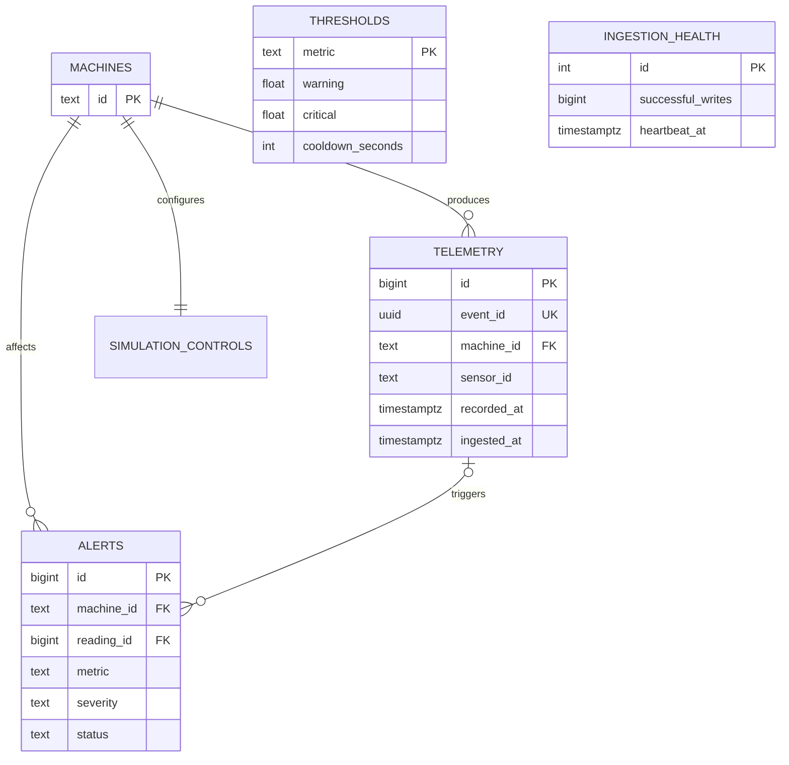

# Database design

PostgreSQL is both the system's durable notebook and its notification source. Relational constraints protect data even if an application bug bypasses validation; SQL supports history, grouping, and joins without another analytics store.



Schema: [`database/01-schema.sql`](../database/01-schema.sql). Indexes: [`database/02-indexes.sql`](../database/02-indexes.sql). Seed: [`database/03-seed.sql`](../database/03-seed.sql).

| Table | Purpose |
|---|---|
| `machines` | Stable asset ID/name/type/location and registration UTC time |
| `telemetry` | Immutable event UUID, numeric sensor readings, status, source time, database time |
| `alerts` | Observed/threshold values, severity, acknowledgement, linked reading and asset |
| `thresholds` | High warning and critical limits plus cooldown per metric |
| `simulation_controls` | Persisted scenario per machine |
| `ingestion_health` | Singleton collector heartbeat and cumulative insert/failure/drop counters |

NOT NULL, status CHECKs, numeric ranges, foreign keys, and a unique event UUID protect the contract. Real values cannot be NaN through Python; PostgreSQL's bounded comparisons also reject nonfinite values outside the checks. Alert reading references become null when retention removes old readings, while observed values remain available until alert retention.

## Transactions, ACID, and idempotency

Think of a transaction as publishing a complete page of the logbook at once. Other readers see the committed result or none of it.

- **Atomicity:** a failed row rolls back all new rows, derived alerts, counters and notification in the batch.
- **Consistency:** SQL constraints and foreign keys reject impossible references and values.
- **Isolation:** the ingestion advisory lock serializes supported writers. Bootstrap uses repeatable read so history and watermark agree. Normal REST queries use default read committed isolation.
- **Durability:** PostgreSQL WAL persists committed data; the Compose named volume survives ordinary container recreation. Backups are still necessary.

`ON CONFLICT(event_id) DO NOTHING` gives idempotent writes. Repeated events do not duplicate rows or create new alerts. A retry after an uncertain commit uses the same event UUIDs. Sequence gaps after rollbacks/conflicts are expected, harmless, and must not be treated as missing records.

Parameters (`%s` in psycopg, `$1` in node-postgres) separate SQL structure from values. Dynamic metric names are restricted to a four-value enum before interpolation. Test and benchmark schema names come from internal UUIDs, never API input.

## Index strategy

A B-tree is a sorted lookup structure. The composite index `(machine_id, recorded_at DESC, id DESC)` first finds a machine, then its newest readings. Column order matters: a time-only filter needs the separate `(recorded_at DESC, id DESC)` index. The primary-key index supports `id > cursor` streaming and reverse-ID history pages.

`telemetry_ingested_idx` bounds 30-second ingestion statistics. Alert indexes serve cooldown checks and active-alert pagination. Every index costs disk and insert maintenance. `DISTINCT ON` latest queries can scan substantial retained history; a materialized latest-state table is a sensible next optimization at much larger volume.

History REST pages are ordered by ingestion ID, even when event timestamps arrive out of order. The UI labels this as newest ingestion first; charts sort by event time. A 31-day maximum query window, 1,000-row maximum page, statement timeout, and API rate limit bound work. Minute aggregation returns the newest 2,000 machine-minute buckets; the aggregate min/max/avg/count covers the entire bounded selection and `truncated` signals chart truncation.

## Retention

`Database.cleanup()` runs about once per minute, deleting at most 10,000 old alerts and 10,000 old readings per cycle. `RETENTION_DAYS=7` by default. This is gradual retention, not a strict row/disk quota. If expiration exceeds 10,000 rows per minute, cleanup can lag. Counters remain lifetime totals and therefore can exceed retained row count. Future deployments should use date partitions, disk alerts, automated vacuum tuning, and tested backups.

## Connection management

Python reuses one autocommit connection and opens explicit transactions; errors close the connection before retry. Psycopg pipelines the batch statements. Node uses a 12-connection pool for concurrent requests and replay; LISTEN has a dedicated reconnecting connection so it is never returned to the request pool. A pool avoids connecting for every HTTP request but is still a finite shared resource.

## Queries and execution plans

[`queries.sql`](queries.sql) contains executable examples for latest readings, machine history, min/max/average, hourly aggregation, active-machine counts, abnormal temperature, critical alerts, and EXPLAIN ANALYZE.

Example from `queries.sql`:

```sql
EXPLAIN (ANALYZE, BUFFERS)
SELECT * FROM telemetry
WHERE machine_id='MCH-001'
  AND recorded_at > now()-interval '1 hour'
ORDER BY recorded_at DESC,id DESC LIMIT 100;
```

EXPLAIN describes the plan; ANALYZE actually executes the query and measures it. BUFFERS shows cache/disk page activity. Never run EXPLAIN ANALYZE on a mutating query casually. The benchmark safely compares a separate 100,000-row table before and after indexing; actual plans and timings are in [PERFORMANCE.md](PERFORMANCE.md).

The database image initializes only an empty volume. Editing SQL files does not migrate existing volumes. For retained installations, add explicit reviewed migration scripts; do not delete the volume to update real data.

The default stale threshold is 15 seconds. When INGEST_INTERVAL is increased, the backend reports `stale_after_seconds = max(15, interval × 3)` (up to 180 seconds); the dashboard uses this value. Keep backend and collector interval configuration aligned.
